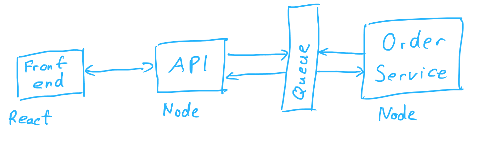
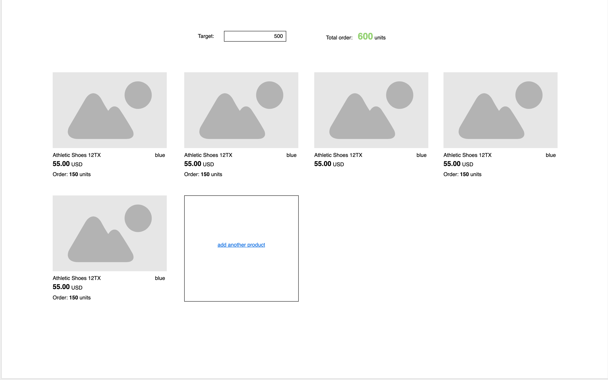

# Products tracking - exercise

The idea behind this small project is to display a very basic product catalog with orders and tracking against a target for the catalog.

## General notes
- No data persistence required, it's enough if API stores data in memory.
- Less is more! Rather complete fewer tasks but make them work correctly.
- Project architecture includes the following:

## Project architecture


- Frontend: react app
- API (server): express app
- Order service: express app
- Queue: very naïve message queue, just for the sake of simple async messaging between API and Order service

### Data exchange between components
- From _Frontend_ to _API (server)_ standard HTTP requests (fetch/axios/whatever)
- Between _API_ and _Order service_ just async message exchange via the _queue_ (ala pub-sub)
- No connection between _Frontend_ and _Order service_, or _Frontend_ and the _queue_. That the service is not part of the _API_ should be transparent for the _Frontend_.

## Tasks

### Mockup of the solution


### Task list
#### Task #1 Add a new product to the catalog
    
1. On the frontend there should be a button that calls an endpoint that adds a new product to the catalog
2. On the API the endpoint can take product data from `services/dataProvider.js` :
    
```

const dataProvider = require('./services/dataProvider')
dataProvider.getNewProduct()

// returns a random entry from mockProductData: 
{
    name: string
    price: number
    currency: string
    photo: string - URL to an image
    color: string
}

```

#### Task #2 Display list of products from server
1. Create an endpoint that would return product data from the catalog - where random products would be added using the endpoint from previous task
2. Display on frontend a grid of the products with the following details (see mockup above or as `mockup.png`):
    * Photo
    * Name
    * Price + currency
    * Color

#### Task #3 Add an order to a product from the order service once a product is created
1. When adding a new product send a message to the order service via the queue about the added product
2. On the order service listen to the product created message and send back to API order quantities via the queue. The quantities can be simply a random number between let's say 100 and 1000)
3. Extend the frontend to display the order quantities for each product

**How this could be done:**
1. Frontend calls API endpoint to add a new product
2. API gets some new mock data and stores it in some in memory list
3. Same time API sends a message about new product to the queue
4. Order Service listens on the queue for the new product message and as the handler sends another message to the queue with the random quantity
5. API listens to the quantity messages and extends the data stored in memory with the quantity when received.
6. Next time when frontend fetches the list the product entry will be extended with the quantity and it will be rendered on the frontend.

#### (optional) Task #4 Allow specifying target and display sum of order quantities
1. On the frontend add an input to allow specifying a target for order quantity. This should be a number.
2. Sum up the current order quantity for the products and display it next to the target.
3. If the sum of the current quantity is greater or equal to the target then color the sum green.
4. [Note] all this can happen only on the frontend, there is no need to send target to the server

#### (optional) Task #5 Display order quantity live on frontend
1. Update product order quantities on the frontend without the need to reload the page (e.g. using websockets or repeated polling)

## Boilerplate
Based on: https://github.com/crsandeep/simple-react-full-stack

### How to run?
For development:

```
yarn install
yarn dev
```

`yarn dev` starts all 3 components

### Folder structure
Source code for all 3 apps is in `src` folder.
- src
    - `client`: this is code of the react app
    - `orderService`: code for the service express app
    - `server`: code for the API express app
    - `shared`: contains `queueService` shared between `server` and `orderService`.  generic utils, for example for random number generation.

### How to use the queue?
There are 2 listeners of the queue initialized when starting the app, the API and the Order service.
Each listener will receive each message that is sent, so you should just ignore the ones that you are not interested in.

#### Sending messages
In the `src/shared` folder there is a `queueService.js` which exposes the `sendMessage` function.
`sendMessage` expects a messageType and the data:
* `messageType` is a required string that you will use to identify whether you want to handle the message or not
* `data` is the actual content of the message

Example of how to send a message is in `src/server/index.js` line 14

#### Listening to messages
When a new message is received then `messageHandler` is called in the given service.
The new message type that we want to handle can be just added to the swith-case.

Example of how to handle a message can be found in `src/server/messageHandler.js`.
